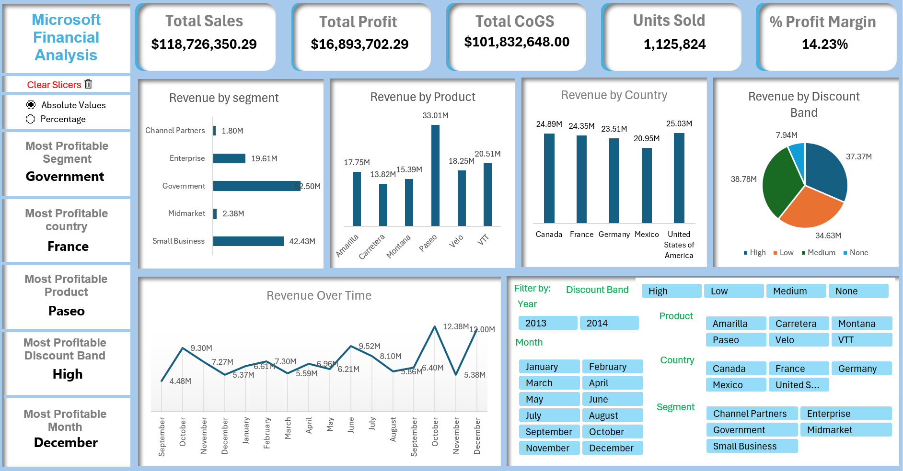

# Microsoft Financial Analysis | Excel

**Revenue, Gross Profitability and Business Performance Analysis (2013–2014)**

* **Tools:** Microsoft Excel
* **Project Category:** Data Analytics
* **Focus:** Financial and Business Performance Analysis
* **Analysis Period:** September 2013 – December 2014

## Project Overview

This project analyses the **Microsoft Financial Sample Dataset** using **Microsoft Excel** to evaluate revenue performance, gross profitability, product performance, geographical markets, customer segments, and discount patterns.

The objective was to transform raw financial data into meaningful business insights that can support financial monitoring and business decision-making. The project involved data validation, exploratory data analysis, financial calculations, PivotTables, PivotCharts, and the development of an interactive Excel dashboard.

## Project Objectives

* Evaluate overall revenue, Cost of Goods Sold (COGS), gross profit, and gross profit margin.
* Identify the products contributing most to revenue and gross profitability.
* Compare financial performance across geographical markets.
* Analyse revenue and profitability across customer segments.
* Examine the relationship between discount levels and gross profitability.
* Identify monthly and yearly financial performance trends.
* Develop an interactive dashboard for exploring business performance.

## Dataset Overview

| Attribute | Description |
| :--- | :--- |
| **Dataset** | Microsoft Financial Sample Dataset |
| **Total Records** | 700 |
| **Total Columns** | 16 |
| **Analysis Period** | September 2013 – December 2014 |
| **Products** | 6 |
| **Countries** | 5 |
| **Customer Segments** | 5 |
| **Tools** | Microsoft Excel |

The dataset contains financial and sales information, including revenue, gross sales, discounts, COGS, profit, units sold, products, countries, and customer segments.

## Tools and Techniques

* **Tool:** Microsoft Excel

**Techniques applied:**
* Data inspection and validation
* Duplicate and missing-value checks
* Exploratory Data Analysis (EDA)
* PivotTables and PivotCharts
* Financial calculations and performance metrics
* Revenue and gross profit analysis
* Gross profit margin analysis
* Discount performance analysis
* Time-series analysis
* Interactive dashboard development
* Slicers and dynamic filtering

## Key Performance Indicators

| Metric | Result |
| :--- | ---: |
| **Gross Sales** | 127.93 Million |
| **Discounts** | 9.21 Million |
| **Net Sales / Revenue** | 118.73 Million |
| **Cost of Goods Sold** | 101.83 Million |
| **Gross Profit** | 16.89 Million |
| **Gross Profit Margin** | 14.23% |
| **Units Sold** | 1,125,824 |

> **Note:** Gross profit is calculated as net sales minus COGS. It does not represent net income.

## Key Business Insights

### 1. Product Performance
* **Paseo** generated the highest revenue and absolute gross profit, contributing approximately **33.01 million** in revenue and **4.80 million** in gross profit.
* **Amarilla** recorded the highest gross profit margin at **15.86%**.
* **Velo** recorded the lowest gross profit margin at **12.64%**, highlighting an area for further investigation.

### 2. Geographical Performance
* The **USA** generated the highest revenue at approximately **25.03 million**.
* **France** recorded the highest absolute gross profit at approximately **3.78 million**.
* **Germany** achieved the highest gross profit margin at **15.66%**.
* The **USA** recorded the lowest gross profit margin at **11.97%**, despite generating the highest revenue.

### 3. Customer Segment Performance
* **Government** was the largest contributor, generating approximately **52.50 million** in revenue and **11.39 million** in gross profit.
* **Channel Partners** recorded the highest gross profit margin at **73.13%**, although its revenue contribution was relatively small.
* **Enterprise** was the only loss-making segment, recording a negative gross profit of approximately **614,545.62** and a margin of **-3.13%**.
* **Small Business** generated the second-highest revenue but recorded a relatively low gross profit margin of **9.77%**.

### 4. Discount Analysis
* The **High Discount** band recorded the lowest gross profit margin at **9.07%**.
* The **No Discount** band recorded the highest gross profit margin at **21.86%**.
* The **Low Discount** band generated the highest absolute gross profit at approximately **6.19 million**.

These findings indicate an association between discount levels and gross profitability, although they do not establish causation.

### 5. Time-Series Analysis
* **October 2014** recorded the highest monthly revenue at approximately **12.38 million**.
* **December 2014** generated the highest monthly gross profit at approximately **2.03 million**.
* **November 2013** recorded the lowest monthly gross profit margin at **10.53%**.
* The comparable **September–December** periods showed an improvement in gross profit margin from **14.68%** in 2013 to **15.03%** in 2014.

## Interactive Excel Dashboard

The project includes an interactive Excel dashboard designed to provide a consolidated overview of financial performance. The dashboard includes:

* KPI cards for revenue, gross profit, COGS, units sold, and gross profit margin.
* Revenue distribution by customer segment.
* Revenue by product.
* Revenue by country.
* Revenue by discount band.
* Monthly revenue trends.
* Interactive slicers for filtering by year, month, product, country, segment, and discount band.
* Options for viewing absolute values and percentage contributions.

### Dashboard Preview

## Business Recommendations

Based on the analysis, the following recommendations were identified:

1. **Review Enterprise profitability:** Investigate pricing, product mix, and cost structures contributing to the segment's negative gross profit.
2. **Improve discount management:** Evaluate high-discount transactions to determine whether additional sales justify reduced gross profit margins.
3. **Investigate USA market profitability:** Examine the factors contributing to its relatively low gross profit margin.
4. **Maintain focus on high-performing products:** Continue monitoring Paseo's contribution to gross profit and Amarilla's strong margin.
5. **Evaluate high-margin customer segments:** Investigate opportunities to grow Channel Partners and Midmarket while maintaining sustainable margins.
6. **Strengthen financial monitoring:** Use interactive dashboards to regularly monitor revenue, gross profit, and profitability across business dimensions.

## Project Files

| File / Folder | Description |
| :--- | :--- |
| Dataset/ | Original financial sample dataset |
| Excel/ | Excel workbook containing the analysis and dashboard |
| Dashboard_Screenshots/ | Dashboard screenshots |
| Report/ | Detailed financial analysis report |
| README.md | Project overview and key findings |

## Limitations

* The analysis covers only 16 months, limiting long-term trend and seasonal analysis.
* The 2013 and 2014 reporting periods are unequal.
* The dataset provides COGS but does not include a complete breakdown of operating expenses; therefore, the analysis focuses on gross profitability rather than net income.
* The analysis is descriptive and does not establish causal relationships.
* The dataset's currency denomination should be confirmed from its original documentation.

## Conclusion

This project demonstrates how Microsoft Excel can be used to analyse financial data, evaluate business performance, identify profitability patterns, and communicate insights through interactive visualizations.

The analysis highlights the importance of looking beyond revenue to understand gross profitability across products, geographical markets, customer segments, and discount categories. It also demonstrates practical skills in data validation, exploratory analysis, financial calculations, data visualization, dashboard development, and business-oriented reporting.
